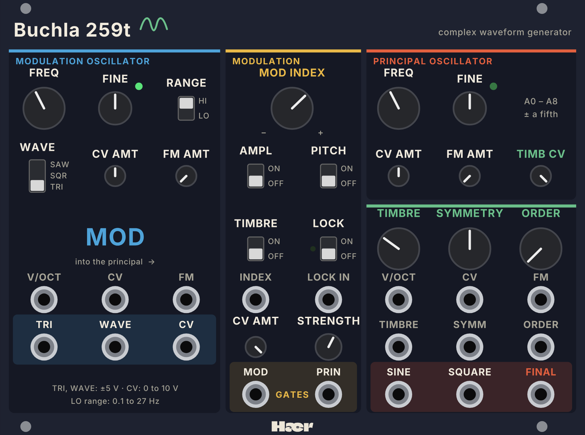

# Buchla 259t for VCV Rack

A complex oscillator for VCV Rack 2, laid out after the Buchla / Tiptop Audio
259t. Original DSP and panel art by Haer; no Buchla or Tiptop artwork is used.

- **Modulation oscillator**: FREQ (A0 to A8), FINE (± a fifth), RANGE (HI audio / LO LFO), WAVE (saw, square, triangle), V/OCT, CV with amount, audio FM with amount. Outputs: TRI, WAVE, CV (unipolar 0 to 10 V), GATE.
- **Modulation**: MOD INDEX (bipolar) with CV, and three routes from the mod osc into the principal: AMPL (AM), PITCH (FM, linear through zero; right-click for exponential), TIMBRE. PHASE LOCK pulls the principal onto a harmonic of the mod osc, or of whatever is in LOCK IN, with a STRENGTH knob.
- **Principal oscillator**: FREQ, FINE, V/OCT, CV with amount, audio FM with amount. Outputs: SINE, SQUARE, FINAL, GATE.
- **Timbre**: TIMBRE (how much shaping, with CV amount), SYMMETRY, ORDER. ORDER left is a wavefolder (SYMMETRY offsets it for even harmonics); ORDER right is a shaper where TIMBRE fades the sine into a wave that SYMMETRY sweeps from sawtooth to an "M" pseudo-square.
- Polyphonic (up to 16 channels), 4x oversampled.

## Build

GitHub Actions builds the Mac (Apple Silicon) plugin on every push; it appears on the "preview" (branches) or "latest" (main) release.
Locally: `make RACK_DIR=path/to/Rack-SDK dist`. Engine checks without the SDK: `make test`. Demo: `test/render demo.wav`.
Panel: `python3 res/make_panel.py` (needs fonttools), preview: `python3 tools/preview.py panel-preview.png`.

## Licence

MIT (see `LICENSE.txt`): you're free to use, change, port (VST/CLAP, other platforms, hardware) and share this code, as long as the copyright notice and licence text come along. Fonts on the panel (Inter, Climate Crisis) are under the SIL Open Font Licence.
